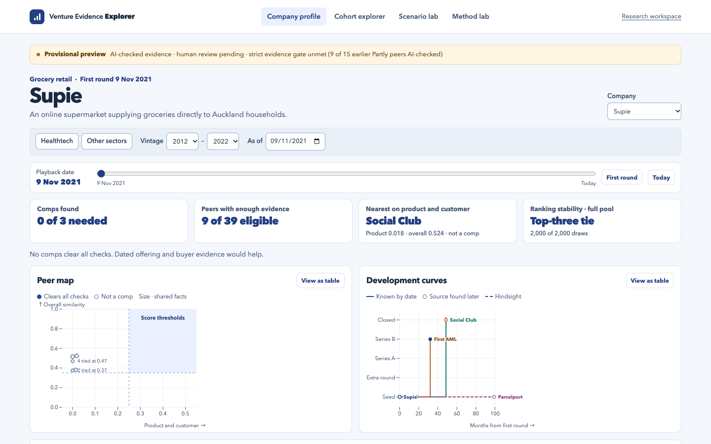

[Open Venture Evidence Explorer on GitHub Pages](https://spar473.github.io/venture_evidence_explorer/)

# Venture Evidence Explorer

A local workbench that compares an early New Zealand venture against sourced company histories. Every fact carries its source, its publication or witness date and a locator. Comparisons use only what was public at the same stage. The workbench abstains from naming comps or showing rates until the evidence clears fixed, published bars.

**For:** seed and pre-seed investors, and university commercialisation teams, who want to see what happened to comparable NZ ventures, and why, without hindsight or paid databases.



## 3-minute demo

1. **Company profile** · 0:00–1:00. Open [Supie at its first round](https://spar473.github.io/venture_evidence_explorer/?view=profile&company=public_supie&asof=2021-11-09). Read the provisional banner and the comparison checks. Select a peer mark to see its scored facts, then move playback to **Today**. Open the **Liquidation** mark and follow its Companies Office source.
2. **Cohort explorer** · 1:00–1:40. Select a vintage segment to list its companies. Switch the event strip to **Outcome** and use **View as table** on the evidence heatmap.
3. **Scenario lab** · 1:40–2:30. Select **Business buyer**, then change **Business model** to **Subscription**. The counts move from four to five qualifying peers. Inspect the later dated records and the four-way tie in the recorded ranking.
4. **Method lab** · 2:30–3:00. Check the three real audit counts, then inspect the synthetic curves, interval and held-out plot.

The four analytics views run locally and on GitHub Pages. `?page=timemachine` and `?page=precedents` open Company profile. Add `?mode=workbench` for the previous server-backed workbench or `?mode=research` for the research workspace.

## Run it

Python 3.10–3.13 and Node 22.12+. The built app needs no network, credentials or paid APIs, and binds to loopback only. Use the project's own `.venv`, not a system or Anaconda Python, whose packages may be too old.

```sh
python3 -m venv .venv
.venv/bin/python -m pip install -r requirements.lock.txt
(cd frontend && npm ci && npm run build)
.venv/bin/python scripts/healthtech_demo.py --serve --port 8000   # http://127.0.0.1:8000
```

`healthtech_demo.py` builds a fresh, disposable database on every start, with the research packets, cohort and reference pool loaded. Use it for local testing and for the demo. `scripts/bootstrap.py` followed by `scripts/serve.py` serves only the base evidence database: the Outcome library works there, but Precedents and the University watchlist stay empty until research packets are imported (see [docs/research_import.md](docs/research_import.md)).

To build the static demo locally, run the export and serve the build directory over HTTP. The Pages workflow runs these steps and publishes after changes reach `main`.

```sh
.venv/bin/python scripts/export_static.py
(cd frontend && node --experimental-strip-types --test test/scorer-parity.mjs && npm run build:static)
.venv/bin/python -m http.server 8000 --bind 127.0.0.1 --directory frontend/dist
```

The export includes all three registered subjects, entry and later event clocks, presets, seed-7 weight checks and a SHA-256 manifest. Custom scenario scoring runs in the browser on the static build. Run `.venv/bin/python scripts/synthetic_cohort.py --seed 7` to reproduce the labelled Method lab files.

Checks (all run in CI):

```sh
.venv/bin/python -m pytest -q
.venv/bin/python scripts/export_contract.py --check
(cd frontend && npx playwright install chromium && VEE_PYTHON="$PWD/../.venv/bin/python" npx playwright test)
.venv/bin/ruff check backend scripts tests && .venv/bin/ruff format --check backend scripts tests   # .venv/bin/python -m pip install -r requirements-dev.txt
(cd frontend && npm run format:check)
.venv/bin/pyright --pythonpath .venv/bin/python
```

Use one command to reproduce the provisional cases.

```sh
.venv/bin/python scripts/preview_backtest.py
```

The run is saved under `outputs/preview/` with its SHA-256 in the file name. To test a changed decision, edit a copy of `research/healthtech-pilot/backtest-review-decisions.csv` and record the date in that row. Pass `--decisions /path/to/copy.csv` to `scripts/ingest_backtest_review.py`, `scripts/audit_backtest_coverage.py` and `scripts/preview_backtest.py`, and compare the results. The original proposals and earlier run files remain available. The local demo picks up changes to the checked-in CSV on its next request. Set `VITE_TIME_MACHINE_TRACK=strict` and, optionally, `VITE_TIME_MACHINE_SUBJECT=public_partly` at frontend build time to show the strict track. The strict endpoint currently refuses the run.

## Method and limits

- [Comparison method](docs/design/COMPS_METHOD.md): anchors, witnessed snapshots, Gower similarity and α weights (§3.1), the comps rules, and the locked estimator.
- [Outcome rules and cohort plan](docs/healthtech-pilot/NEXT_PHASE_PLAN.md): the frozen entry rule, primary and secondary outcomes, and the release gate.
- [Data status](STATUS.md): the latest data checks and open data decisions.
- [Time Machine preregistration](docs/design/BACKTEST_PREREG.md), [case results](docs/healthtech-pilot/PREVIEW_RESULTS.md) and [acceptance evidence](docs/healthtech-pilot/PREVIEW_EVALUATION.md) explain the provisional preview and its data limits. The strict 15-peer requirement is still unmet.
- [Data use](DATA_USE.md): public sources only, paraphrased passages, no bulk extraction, and how to request a correction.
- [Validation](VALIDATION.md) · [Next steps](NEXT_STEPS.md) · [Changelog](docs/CHANGELOG.md) · [API contracts](docs/research_api.md)

**Limits.** The cohort has 55 confirmed entries, 2 verified primary outcomes, 33 unknown and 10 lost to follow-up. Supie has zero qualifying peers on its recorded facts. Partly and Halter have no scoreable entry facts. The audit gate covers the full cohort. The date filter changes event playback and cohort follow-up. Scenario scores use the same frozen entry cutoff. See the [analytics evaluation](docs/ANALYTICS_EVALUATION.md) for evidence and known gaps.

More captures are available for the [Outcome library](docs/healthtech-pilot/screenshots/workbench-outcome-library.png), [Precedent overview](docs/healthtech-pilot/screenshots/workbench-overview.png) and [Evidence](docs/healthtech-pilot/screenshots/workbench-evidence.png).

Code and associated documentation: [MIT licence](LICENSE). Curated evidence and third-party sources have separate terms; see [DATA_USE.md](DATA_USE.md).
