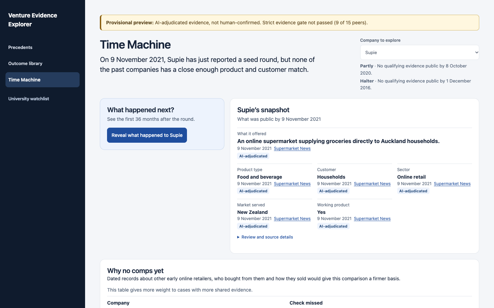
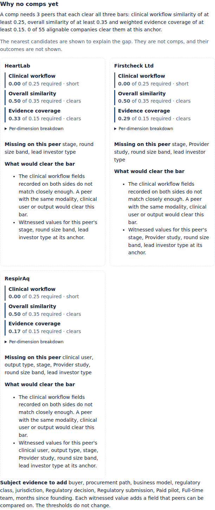

# Venture Evidence Explorer

A local workbench that compares an early New Zealand venture against sourced company histories. Every fact carries its source, its publication or witness date and a locator. Comparisons use only what was public at the same stage. The workbench abstains from naming comps or showing rates until the evidence clears fixed, published bars.

**For:** seed and pre-seed investors, and university commercialisation teams, who want to see what happened to comparable NZ ventures, and why, without hindsight or paid databases.



## 3-minute demo

Start the server under [Run it](#run-it).

1. **Time Machine** (0:00–1:00). Open [Supie in the Time Machine](http://127.0.0.1:8000/?page=timemachine). Read the provisional banner and the snapshot dated 9 November 2021. Scroll to **Nearest available, not comps** to see why even Social Club misses the product and customer check. Select **Reveal what happened to Supie** and open the Companies Office link beside Liquidation.
2. **Outcome library** (1:00). Open **Stories worth knowing** and find Halter's Series A. Switch *Series A or later* to *Next priced equity round* to see how the two definitions change the counts.
3. **Precedents ▸ Evidence** (1:45). Open **Evidence → Comparison snapshots** for the **Public by** date, publisher and locator. Switch **Peer evidence** to see the `+n days` late-evidence badges.
4. **Comps abstention and Outlook** (2:25). Search **Toku Eyes** and open **Overview → Why no comps yet**. HeartLab's clinical workflow score is 0.00 against a 0.25 requirement. **Outlook** lists the separate data requirements.

`/?page=precedents` opens the precedent workbench directly; `/?mode=research` opens the older research views.



## Run it

Python 3.10–3.13 and Node 22.12+. The built app needs no network, credentials or paid APIs, and binds to loopback only. Use the project's own `.venv`, not a system or Anaconda Python, whose packages may be too old.

```sh
python3 -m venv .venv
.venv/bin/python -m pip install -r requirements.lock.txt
(cd frontend && npm ci && npm run build)
.venv/bin/python scripts/healthtech_demo.py --serve --port 8000   # http://127.0.0.1:8000
```

`healthtech_demo.py` builds a fresh, disposable database on every start, with the research packets, cohort and reference pool loaded. Use it for local testing and for the demo. `scripts/bootstrap.py` followed by `scripts/serve.py` serves only the base evidence database: the Outcome library works there, but Precedents and the University watchlist stay empty until research packets are imported (see [docs/research_import.md](docs/research_import.md)).

Checks (all run in CI):

```sh
.venv/bin/python -m pytest -q
.venv/bin/python scripts/export_contract.py --check
(cd frontend && npx playwright install chromium && VEE_PYTHON="$PWD/../.venv/bin/python" npx playwright test)
.venv/bin/ruff check backend scripts tests && .venv/bin/ruff format --check backend scripts tests   # .venv/bin/python -m pip install -r requirements-dev.txt
(cd frontend && npm run format:check)
.venv/bin/pyright --pythonpath .venv/bin/python
```

Use one command to reproduce the provisional cases.

```sh
.venv/bin/python scripts/preview_backtest.py
```

The run is saved under `outputs/preview/` with its SHA-256 in the file name. To test a changed decision, edit a copy of `research/healthtech-pilot/backtest-review-decisions.csv` and record the date in that row. Pass `--decisions /path/to/copy.csv` to `scripts/ingest_backtest_review.py`, `scripts/audit_backtest_coverage.py` and `scripts/preview_backtest.py`, and compare the results. The original proposals and earlier run files remain available. The local demo picks up changes to the checked-in CSV on its next request. Set `VITE_TIME_MACHINE_TRACK=strict` and, optionally, `VITE_TIME_MACHINE_SUBJECT=public_partly` at frontend build time to show the strict track. The strict endpoint currently refuses the run.

## Method and limits

- [Comparison method](docs/design/COMPS_METHOD.md): anchors, witnessed snapshots, Gower similarity and α weights (§3.1), the comps rules, and the locked estimator.
- [Outcome rules and cohort plan](docs/healthtech-pilot/NEXT_PHASE_PLAN.md): the frozen entry rule, primary and secondary outcomes, and the release gate.
- [Data status](STATUS.md): the latest data checks and open data decisions.
- [Time Machine preregistration](docs/design/BACKTEST_PREREG.md), [case results](docs/healthtech-pilot/PREVIEW_RESULTS.md) and [acceptance evidence](docs/healthtech-pilot/PREVIEW_EVALUATION.md) explain the provisional preview and its data limits. The strict 15-peer requirement is still unmet.
- [Data use](DATA_USE.md): public sources only, paraphrased passages, no bulk extraction, and how to request a correction.
- [Validation](VALIDATION.md) · [Next steps](NEXT_STEPS.md) · [Changelog](docs/CHANGELOG.md) · [API contracts](docs/research_api.md)

**Limits.** The cohort is 55 confirmed entries, with 2 primary outcomes and 33 unknown, so no rate is shown. No real subject has comps yet; the abstention panel shows what evidence is missing. The Outcome library and the gates are present-day views and ignore the As-of date. Sources are public and can go offline; archived captures are the next data task.

More captures are available for the [Outcome library](docs/healthtech-pilot/screenshots/workbench-outcome-library.png), [Precedent overview](docs/healthtech-pilot/screenshots/workbench-overview.png) and [Evidence](docs/healthtech-pilot/screenshots/workbench-evidence.png).

Code and associated documentation: [MIT licence](LICENSE). Curated evidence and third-party sources have separate terms; see [DATA_USE.md](DATA_USE.md).
