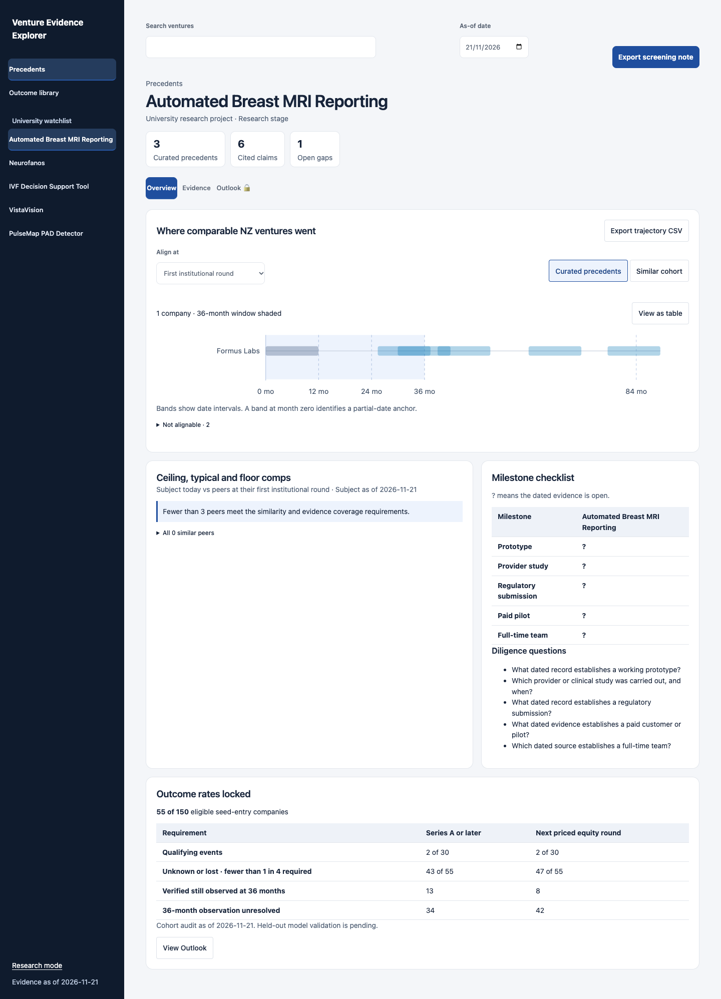
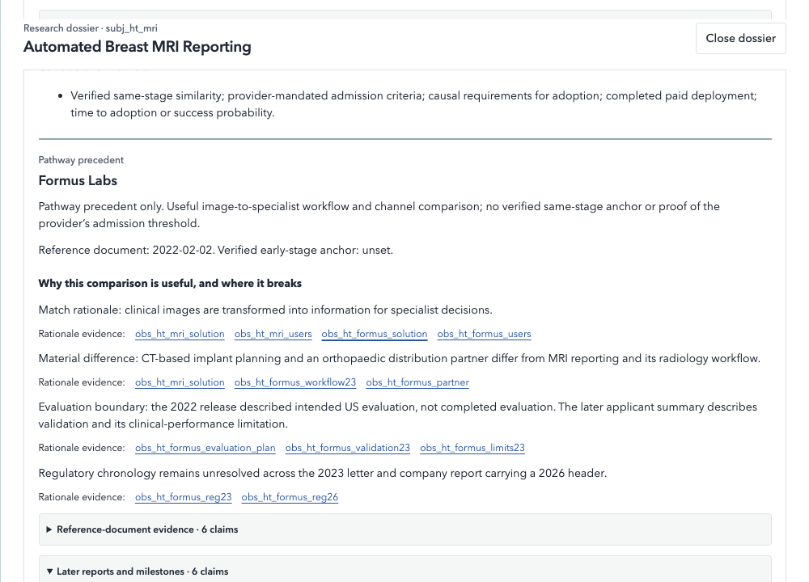

# Venture Evidence Explorer

Compare early NZ ventures against sourced company histories in the Precedent & Outcome Workbench.<br>
Align peers at institutional funding, provider or clinical study, regulatory decision or first paid customer.<br>
Inspect dated evidence, known outcomes and unanswered diligence questions.<br>
Export an unweighted screening note for Venture Frame. Outcome rates require cohort coverage and held-out validation.<br>
Start with **Precedents → Automated Breast MRI Reporting → Overview**. [Comparison method](docs/design/COMPS_METHOD.md)



More captures: [Evidence](docs/healthtech-pilot/screenshots/workbench-evidence.png) · [Outcome library](docs/healthtech-pilot/screenshots/workbench-outcome-library.png). The [browser tests](frontend/e2e/workbench.spec.ts) regenerate them. The [verification log](docs/healthtech-pilot/STATUS.md#round-review--21-november-2026) records the latest run.

## Two-dossier integration pilot · Prompt 1

Research interchange **0.2.1** is now supported through a separate validated, transactional adapter and namespaced research graph. It is not application input version 1 or 2. **Research dossiers** opens the supplied RosterLab and QuickMas evidence, unknowns, events/targets, unresolved cases, and question-specific supported versus withheld conclusions. Their existing-app identity links remain proposed; no legal identity, human acceptance or B0 feature projection is invented.

```sh
# After installing requirements.lock.txt and backing up an existing SQLite DB:
python scripts/bootstrap.py
python scripts/import_research.py --db outputs/venture_evidence.sqlite --as-of 2026-11-18 --report outputs/research-dry-run.json
python scripts/import_research.py --db outputs/venture_evidence.sqlite --as-of 2026-11-18 --apply --report outputs/research-import.json
python scripts/verify_research.py
python scripts/export_research.py --db outputs/venture_evidence.sqlite --output-dir outputs/research-exports
```

Dry run is the default and reports every mapped, preserved, quarantined or unsupported field without writes. See `docs/research_import.md`, `docs/research_api.md`, `docs/pilot_identity_review.md` and the current `engineering_completion.md`. Frozen research-package completion reports describe their historical snapshots; the root report describes this pilot. `PILOT_SHA256SUMS.txt` is the new source manifest; prior engineering/release manifests remain historical provenance. Restart an already running API after upgrading code/schema. Startup never silently imports dossiers.

## Engineering review implementation · 18 November 2026

Core phases A–F are implemented: atomic migrations, strict reusable imports, versioned historical evidence, explicit retrieval policies, paginated summaries and lazy profiles, generated API types, reproducible comparison exports/replay, modular UI and runnable evaluation/CI infrastructure. The historical B0 scoring version and original evidence remain intact. Review-era specifications/manifests remain provenance records, not current checksums.

See `docs/evidence_contract.md` for input versions, unknown/partial dates and recovery; `docs/api_and_comparison_runs.md` for the paginated API and replay limits; and `docs/academic_extensions.md` for research prerequisites. E1/E3 are scaffolded, E2 is implemented with a synthetic-only demo, and E4/sequential decisions are deferred. No research data or human judgments are manufactured. Original blank relevance judgments produce no relevance metrics.

Existing research databases need the additive migration before this version is served. Back up with SQLite's backup API first, then run bootstrap with the original seed. Applied migrations and existing evidence are never rewritten. Input schema 1 remains supported; schema 2 supplies explicit date intervals and typed values only when real records exist.

## Run locally

Python 3.10+ and Node 22.12+ (tested on Python 3.10.10 and Node 26.12.1), with npm. Package installation needs internet; the built application needs no network, credentials or paid APIs. External source links require internet when opened.

From the project directory:

```sh
python3 -m venv .venv
.venv/bin/python -m pip install -r requirements.lock.txt
.venv/bin/python scripts/bootstrap.py
.venv/bin/python scripts/verify.py
cd frontend
npm ci
npm run build
cd ..
.venv/bin/python scripts/serve.py
```

Open http://127.0.0.1:8000. The launcher binds only to loopback. Once dependencies and the frontend are built, restart with `.venv/bin/python scripts/serve.py`. Use `--port 8001` if 8000 is in use. `VEE_DB=/absolute/path.sqlite` selects an existing migrated database. The app never silently replaces or reimports a database on startup. Evidence requests use read-only SQLite connections. Intake saves and workbench claim disputes use separate local write transactions. Disputes preserve the original source claims and the frozen outcome audit.

Install the documented Python dependencies before bootstrap or verification; strict ingestion now uses the already required Pydantic dependency. `python scripts/check_migrations.py` remains standard-library only. Bootstrap imports into `outputs/venture_evidence.sqlite`, applies checksummed migrations and exports database tables/analyses. Do not hand-edit CSVs as a source of truth. `data/seed.json` is the preserved input fixture; the application reads database records only.

Development: run the service, then `cd frontend && npm run dev`. Vite proxies `/api` to loopback port 8000. The normal release serves its built JS/CSS from FastAPI on one origin. No CDN assets, analytics or external fonts are used.

## Implemented

- Search names, aliases and sourced product wording; intersect programme, award year and connection filters. Programme/year must match the same award row. Clear reset, loading, empty and recoverable error states.
- Venture profiles with historical product and relationship observations, recorded awards, source URLs, publishers, publication/retrieval dates, effective/event dates, passage locators and review status. Source spellings are not legal identities. Unknown legal identity, operating status and funding stay null and display as unverified.
- Separate, visibly proposed analyst annotations with links to their evidence basis. No reviewer decisions are invented.
- Select a venture or describe an investigation. Product/customer mode uses product observations; commercialisation mode additionally uses sourced university-origin wording. Explainable B0 lexical ranking returns zero to three candidates, excludes the subject, shows matching terms/fields, source passages, wording differences, unknown evidence and five generic suggested diligence questions.
- Stage/milestone mode explicitly abstains: eligible commercial milestone data is absent. Deterministic/template briefs make no claim to LLM reasoning.
- Three analytical SQL views and CSV exports: recorded recognition by programme/year; overlapping connection types; source publication age and evidence coverage. Raw observations and proposed annotations have separate downloads. Empty CSV cells mean unknown/not recorded.
- Repeatable parameterised imports, immutable-record conflict refusal, rollback, strict imported-column validation, FK/subject checks, database immutability triggers, append-only review-event structure and atomic replacement of each CSV file.

## Demo path

Start the disposable demo from the checkout after building the frontend.

```sh
.venv/bin/python scripts/healthtech_demo.py --serve --port 8006
```

1. At [the local demo](http://127.0.0.1:8006), open **Precedents → Automated Breast MRI Reporting**. Switch the trajectory from the first institutional round to the first regulatory decision and open an event.
2. Open **Evidence**, then select **Comparison snapshots**. Compare the source witnesses and the open cells. The five university projects remain analogy queries; for a company subject the same toggle reads **What was public at the same stage**.
3. Open **Outcome library**. Inspect Partly, Halter, Supie and Tiro Lifesciences, then change the outcome from Series A or later to the next priced equity round.
4. Return to **Precedents → Outlook** for the current cohort counts and permissioned data requirements.
5. Select **Export screening note** and open the JSON in Venture Frame through **Projects → Import**.

The previous directory, comparison and full dossier views are available through **Research mode** in the sidebar (`/?mode=research`).

Research mode:



See the [API and evidence contracts](docs/research_api.md#precedent-workbench) for anchor rules, provenance and outcome scope.

## Verification

```sh
.venv/bin/python scripts/bootstrap.py
.venv/bin/python scripts/verify.py
.venv/bin/python -m pytest -q
cd frontend
npm run build
npx playwright test
```

For browser tests, first run `npx playwright install chromium` in `frontend/`. Playwright automatically bootstraps a disposable temporary database and starts a loopback server; the research database is untouched. Set `VEE_PYTHON` if the installed Python dependencies are in a virtual environment, `VEE_TEST_PORT` to override the test port, `CHROME_PATH` to opt into a local compatible Chromium binary, or `VEE_URL` to use an already running service. Browser tests cover actual rendered flows, CSV downloads, API failure recovery, loading and narrow layout. See `VALIDATION.md` for observed results and limits. Backend tests use temporary databases; synthetic reviews/overlaps never enter the release database.

`evaluation/queries.json` contains six development tasks and `evaluation/judgments.csv` remains blank. No precision, nDCG, reviewer agreement, usefulness or time savings is claimed.

## Handover

See `docs/architecture.md` for data flow and PostgreSQL migration path; `docs/decisions.md` for tradeoffs; `NEXT_STEPS.md` for priority extensions. Original specifications and research notes remain as historical starter documents; their future-tense roadmap is not a claim of implemented functionality. `SHA256SUMS.txt` is the original starter manifest, retained for provenance; it does not describe the modified release. The original `RELEASE_SHA256SUMS.txt` is retained for provenance; `ENGINEERING_SHA256SUMS.txt` describes the preceding core implementation; `PILOT_SHA256SUMS.txt` describes this pilot.

No remote repository, deployment, private submissions, contact records or external model integration is included. Power BI-ready CSVs are delivered, not a `.pbix` report. MCDA Studio has not been modified.

## Interface refinement

The directory now uses aligned record columns, a compact filter toolbar and a keyboard-accessible evidence drawer. Comparison and analytical screens share a neutral token system and readable labels. See `docs/design.md` for the design references and current browser verification. No new component libraries or external fonts are required.

## Reproducible engineering checks

```sh
python scripts/check_migrations.py
python scripts/export_contract.py --check
python scripts/evaluate.py --db outputs/venture_evidence.sqlite --output outputs/development-evaluation.json
python scripts/benchmark.py --db outputs/venture_evidence.sqlite --repeats 50
python scripts/benchmark.py --synthetic-ventures 1000 --repeats 20
python scripts/academic_demo.py
```

Comparison JSON exports include logical corpus digests, selected observation IDs/review states, policy/method versions and request/result signatures. Replay refuses a changed corpus or altered record; retain the corresponding SQLite snapshot for later reproduction. Evidence remains read-only through exploration; explicit intake routes append draft revisions in separate transactions. Synthetic scale benchmarks create a temporary corpus and never modify the input database.

The API directory now returns explicit pagination (`items`, `total`, `limit`, `offset`) with summary objects; full assertions remain at the venture detail endpoint. Frontend types are generated from the exported OpenAPI contract. Regenerate with `python scripts/export_contract.py` whenever contracts change; CI checks drift. The committed CI workflow is infrastructure, not a claim that GitHub Actions has run for uncommitted local changes.

## Local intake, discovery and evaluation · Prompts 2–5

**Add venture** saves append-only local drafts, aliases, descriptions and optional attributed claims with original date precision. Local assertions and unreviewed source attribution stay visible. Duplicate suggestions do not resolve identity. Saved drafts supply a literal query under `intake-b0-query-1.0`; their assertions never become trusted corpus evidence. Accepted-only policy and real resolved-subject exclusions remain explicit. See `docs/intake.md`.

**Discovery queue** inspects 274 staged leads across 27 source families, 42 sources and 365 overlapping listings. They are not 274 accepted unique NZ ventures or a national population. Identity, dated NZ/period evidence and independent review remain pending. Source-only appearances cannot promote a venture. See `docs/discovery.md` for dry-run/import and externally supplied review sidecars.

```sh
python scripts/import_discovery.py --report outputs/discovery-dry-run.json
# After backup, stage only:
python scripts/import_discovery.py --db outputs/venture_evidence.sqlite --apply --report outputs/discovery-import.json
python scripts/evaluation_workbench.py freeze --db outputs/venture_evidence.sqlite --output-dir outputs/frozen-evaluation --as-of 2026-11-18
python scripts/evaluation_workbench.py review-materials --bundle outputs/frozen-evaluation --output-dir outputs/human-review
python scripts/evaluation_workbench.py run --bundle outputs/frozen-evaluation --output outputs/evaluation-run.json
```

The frozen evaluation/review workflow preserves blank real judgments, retains reviewer disagreements, checks leakage and computes reviewer-specific metrics only when supplied labels permit. Independent held-out profiles/tasks are explicitly pending. Existing B0 golden results and original evaluation inputs are unchanged. See `docs/evaluation_workbench.md`, `docs/release_reproducibility.md` and the current root `engineering_completion.md` for executed checks, fresh-install blockers and recovery. `REMAINING_SHA256SUMS.txt` describes this source; earlier manifests are retained historical records.

## Current-state review fixes

Saved-draft recovery now retains the draft identity, base revision and uncertain-save request across reload/tab navigation. Stale completions are guarded, switching is disabled during a save, and concurrent server revisions require explicit reconciliation while preserving local edits. Mapping decisions follow indirect source and review chronology; source-less assertions cannot bypass inspection dates. Dossiers lead with attributed venture information and precision-preserving evidence dates; discovery uses readable labels with IDs/raw values still inspectable. See `docs/intake.md`, `docs/research_import.md` and the root `engineering_completion.md`. `REVIEW_FIX_SHA256SUMS.txt` is the current source manifest; all earlier manifests remain historical provenance.

The current-state review fixes (F1–F3) and dossier/discovery presentation refinements are documented in the current root completion report. `REVIEW_FIX_SHA256SUMS.txt` is the latest source manifest; `REMAINING_SHA256SUMS.txt` remains the unchanged Prompts 2–5 provenance record. No new migration, corpus promotion or human decision was required.

## Continue from another computer

The 18 November handover was prepared on `implementation/vee-workbench`; current development continues from `main`. Start with [handover/DESKTOP_START.md](handover/DESKTOP_START.md) for Windows PowerShell and macOS/Linux instructions. [handover/README.md](handover/README.md) indexes supplied documents, verification history, captures, original archives and the consistent evidence snapshot. Runtime databases/dependencies stay local; the restore script refuses to overwrite an existing database.

## Consolidated project handover · 18 November 2026

The latest end-to-end project context is [the master handover](handover/master-2026-11-18/Code_Agent_Handover_v2_2026-11-18.md). It covers the initial plan, expanded NZ research goals, implemented workflows, evidence boundaries, latest fixes and remaining work. [Start here](handover/master-2026-11-18/README.md) for the copy-ready new-chat prompt, complete project archive and snapshot verification. Use the current branch for development; archived source copies are frozen references.

## NZ healthtech comparison pilot · 19 November 2026

Open **Research dossiers** to see how many university projects have a supported comparison. The full pilot has eight project–venture pairs across five distinct reference ventures. MRI Reporting has three precedents covering breast imaging (Volpara), specialist planning (Formus) and hospital MR feasibility testing (Wellumio). Open **Compare elapsed time** to inspect document, event and target dates relative to each precedent’s reference document. PulseMap and the RosterLab contrast abstain. Historical snapshots require verified archive evidence.

```sh
npm --prefix frontend run build
python scripts/healthtech_demo.py --serve --evaluate
```

The command creates a disposable database, verifies dry-run and repeat-import safety, and serves on <http://127.0.0.1:8001>. See [the pilot guide](docs/healthtech-pilot/README.md) for dependency setup, evidence limits and reproducible commands, and [the checkpoint](docs/healthtech-pilot/STATUS.md) for actual verification results. The pilot guide links to the three-method review kit, cash scenario prototype and forecast feasibility check.
