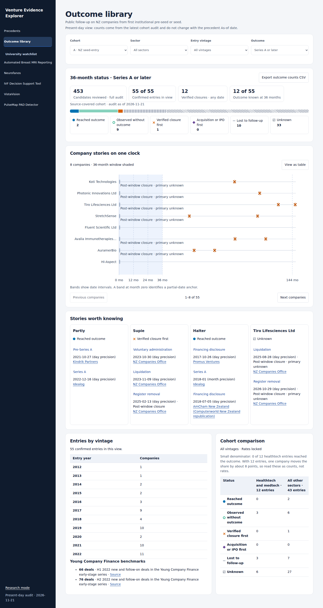

# Venture Evidence Explorer

A local workbench that compares an early New Zealand venture against sourced company histories. Every fact carries its source, its publication or witness date and a locator. Comparisons use only what was public at the same stage. The workbench abstains from naming comps or showing rates until the evidence clears fixed, published bars.

**For:** seed and pre-seed investors, and university commercialisation teams, who want to see what happened to comparable NZ ventures, and why, without hindsight or paid databases.



## 3-minute demo

```sh
.venv/bin/python scripts/healthtech_demo.py --serve --port 8006   # disposable demo database
```

1. **Outcome library** (0:00). The app opens here. Every count links to a dated source; note the healthtech small-denominator line.
2. **Stories worth knowing** (0:40). Open Supie (Icehouse-led seed, then liquidation; click the Companies Office link), then Halter (seed 2016, Series A January 2018).
3. **Outcome toggle** (1:20). Switch *Series A or later* to *Next priced equity round*. The counts move; the definitions are frozen.
4. **Precedents ▸ Evidence** (1:40). Open **Evidence → Comparison snapshots** for witness date, publisher and locator. Switch **Peer witness mode** to see the `+n days` late-witness badges.
5. **Comps abstention** (2:20). Search **Toku Eyes**, then open **Overview → Why no comps yet**. HeartLab clears overall similarity (0.50) but scores 0.00 on clinical workflow against 0.25 required. The thresholds do not move.
6. **Outlook** (2:40). Rates stay locked until there are 150 companies, 30 outcomes and under 25% unknown or lost.

`/?page=precedents` opens the precedent workbench directly; `/?mode=research` opens the older research views.


## Run it

Python 3.10–3.13 and Node 22.12+. The built app needs no network, credentials or paid APIs, and binds to loopback only.

```sh
python3 -m venv .venv
.venv/bin/python -m pip install -r requirements.lock.txt
.venv/bin/python scripts/bootstrap.py && .venv/bin/python scripts/verify.py
(cd frontend && npm ci && npm run build)
.venv/bin/python scripts/serve.py            # http://127.0.0.1:8000
```

Checks (all run in CI):

```sh
.venv/bin/python -m pytest -q
.venv/bin/python scripts/export_contract.py --check
(cd frontend && npx playwright install chromium && npx playwright test)
ruff check backend scripts tests && ruff format --check backend scripts tests   # pip install -r requirements-dev.txt
(cd frontend && npm run format:check)
```

## Method and limits

- [Comparison method](docs/design/COMPS_METHOD.md): anchors, witnessed snapshots, Gower similarity and α weights (§3.1), the comps rules, and the locked estimator.
- [Outcome rules and cohort plan](docs/healthtech-pilot/NEXT_PHASE_PLAN.md): the frozen entry rule, primary and secondary outcomes, and the release gate.
- [Data status](STATUS.md): the latest data checks and open data decisions.
- [Data use](DATA_USE.md): public sources only, paraphrased passages, no bulk extraction, and how to request a correction.
- [Validation](VALIDATION.md) · [Next steps](NEXT_STEPS.md) · [Changelog](docs/CHANGELOG.md) · [API contracts](docs/research_api.md)

**Limits.** The cohort is 55 confirmed entries, with 2 primary outcomes and 33 unknown, so no rate is shown. No real subject has comps yet; the abstention panel shows what evidence is missing. The Outcome library and the gates are present-day views and ignore the As-of date. Sources are public and can go offline; archived captures are the next data task.

More captures: [Precedent overview](docs/healthtech-pilot/screenshots/workbench-overview.png) · [Evidence](docs/healthtech-pilot/screenshots/workbench-evidence.png).

Copyright © 2026. All rights reserved; see [LICENSE](LICENSE).
