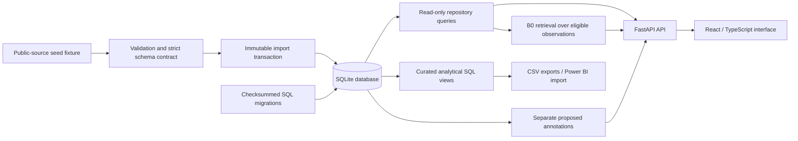

# Architecture and data flow

The first release is a local evidence-inspection tool, not an investment decision system. Analyst and founder investigation tasks require traceable historical statements, overlapping cohort filters and honest abstention. Identity conflation, unsupported current status, stale sources, misleading counts and plausible but irrelevant lexical matches are the main failure cases.

`bootstrap.py` handles ingestion and validation. `schema/schema.sql` remains the baseline contract; numbered migrations add analytical views, review events and immutability enforcement. Applied migration hashes refuse silent rewrites. Each additive migration is transactional. Migrations run before the import transaction, so an empty schema upgrade can remain after a refused data import; all imported data writes roll back together. A failed first import can leave an empty schema/database. Exports start only after successful import and use atomic replacement per file, not a transaction across all CSV files.

`backend/database.py` owns migration execution and read-only connections. `repository.py` returns stable-ID records with source joins. Parameterised `EXISTS` clauses filter actual awards and connections without multiplying venture rows. The programme/year conditions apply to one award row, so a 2025 $100K award and a 2026 Ideas award cannot incorrectly imply a 2026 $100K award. Source aliases create lookup candidates only; identities are never automatically merged.

`retrieval.py` computes B0 from product observations, and optionally university connection observations in pathway mode. All eligible versions remain available; no unsourced latest-status summary is created. Tokens are sets, preventing repeated observations from adding press-volume weight. Search response includes method/version, source-linked matched fields, query text and explicit unknowns. Wording differences are derived vocabulary differences, not verified product comparisons. Reviewed structured matching and semantic retrieval are deferred. Review events are an append-only schema foundation, not a review UI or an accepted-feature pipeline. No actual review events exist in the release database.

FastAPI serves the built React bundle and `/api/*` from loopback. The API has no write endpoints; all runtime database connections are read-only. The service does not bootstrap implicitly. Missing databases return actionable errors, and missing builds return a build instruction. The frontend uses request lifecycle flags to ignore stale browse responses and exposes loading, retry and empty states. Browse and comparison share programme/year/connection settings; candidate filters remain inspectable.

Provenance joins return the exact source record for each observation/award. Connections reuse the linked observation of the same subject. DB triggers and ingestion validation enforce subject linkage. Source observations and proposal basis links remain immutable; corrections require a new observation ID/version and/or append-only review event. There is no private-data ingestion or external text generation. `data/seed.json` remains the preserved import fixture, while SQLite is the sole application/analytical store; CSVs are generated outputs.

## Analytical views and Power BI

- `v_programme_recognition`: awards and distinct ventures by programme/year in this selected sample.
- `v_connection_coverage`: relationship rows and distinct ventures by type; overlapping categories cannot be summed as a unique venture total.
- `v_source_coverage`: distinct observation-linked sources, observation counts, earliest/latest publication, latest retrieval, publication age and UTC as-of date per venture. Ventures with no observations retain null dates/age and zero recorded observations/sources.
- `v_raw_observations` and `v_proposed_annotations`: explicitly separate source material from proposals. No accepted analytical feature view is fabricated.

In Power BI, import the generated CSVs with UTF-8, keep IDs as text and missing cells as null. Use explicit date types and retain `as_of_date`. Relate normalized `ventures` 1:* to observations/awards/connections and `sources` 1:* to observations/awards. Do not join analytical aggregates back to fact tables and re-sum duplicated totals. Annotation evidence is a bridge to proposals, not an accepted feature table. A real report and its usability checks are deferred.

## PostgreSQL migration path (not implemented)

Freeze and back up the SQLite database, retain stable IDs, then create a new PostgreSQL schema from reviewed migration DDL. Use TEXT IDs, DATE columns for source/effective/event dates, JSONB arrays (or normalized alias and evidence tables), explicit programme/decision checks and foreign keys. Replace PRAGMA integrity checks with constraint checks and reconciliation SQL; replace `julianday`/`date('now')` with explicit date subtraction and an as-of date. Port immutability and subject guards to PostgreSQL trigger functions (or enforce composite subject FKs). Use transactional migrations with an equivalent checksum ledger, parameterised inserts with `ON CONFLICT DO NOTHING` followed by full record equality checks, and atomic import transactions.

Reconcile every source/observation/award/link, null count, view denominator, import digest and blank evaluation artifact. Run the same behavioural contracts against a repository adapter with PostgreSQL placeholders and transactions before changing the single configured database connection. Avoid dual-write or a parallel spreadsheet master. PostgreSQL, containers and hosting are not dependencies of this local release.
