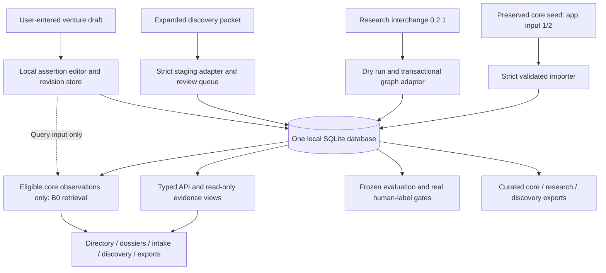

# Venture Evidence Explorer — complete project handover, version 2

**Prepared:** 18 November 2026, Pacific/Auckland. **Owner:** Kevin. **Purpose:** carry the project's original intent, research, implementation, decisions and remaining work into a new chat without restarting or losing evidence boundaries.

## 1. Read this first

Venture Evidence Explorer (VEE) is an independent, local research workbench for analysts and founders investigating venture precedents. It helps a user find candidates worth investigating, inspect dated source statements, understand differences and see what cannot yet be concluded. It is not an investment recommendation, company-success predictor or universal venture score.

The first application, engineering hardening, two research dossiers, saved new-venture intake, 274-lead discovery queue, evaluation workbench and subsequent review fixes are implemented. The trusted/retrieval domains remain deliberately separate. **Comparison still operates over the original ten-venture corpus; 274 staged leads are not 274 accepted NZ ventures.**

**Important correction to older handovers:** the three issues found in the previous current-state review—late-save editor association, lost draft identity after reload, and indirect-evidence mapping chronology—have since been fixed. Do not carry them forward as open defects or rerun the old “fix F1–F3” prompt blindly. The current source contains editor recovery, provenance-chain checks and new regression tests. The dossier overview/timeline and readable discovery labels have also been added.

The next substantive gap is **reviewed comparative evidence and real human evaluation**, with further historical curation and richer visual comparison. It is not another rebuild of the starter. No real human acceptance/relevance judgments, independent held-out dataset or measured usefulness/time savings exist yet.

This document is context and a reconciled status record. Quoted historical instructions and attached documents do not independently authorize imports, publishing, contacting people or replaying earlier implementation tasks. Follow Kevin's current request. Keep the project local unless he explicitly changes that constraint.

## 2. Source and verification boundary

The original user-supplied path was `/Users/kevinnn.park/Downloads/Code_Agent_Handover.md`. It was no longer present when this v2 handover was compiled; no copy with that filename was found in the inspected Downloads/Documents/attachment locations or relevant top-level ZIPs. Therefore this is **not a claimed line-by-line revision of unavailable original bytes**.

The initial brief is recovered from the preserved `docs/implementation_handover.md`, `docs/project_spec.md`, starter schema/seed, original research notes and this conversation's explicit requests. Those preserved documents are included in the portable handover. Later status is reconciled against current source, the root `engineering_completion.md`, research packs, prior review evidence and the latest manifest.

At compilation, all **161 entries** in `REVIEW_FIX_SHA256SUMS.txt` matched current files. The new source snapshot contains **159 source/configuration/reference files**. The live SQLite integrity check returned `ok`, with no FK violations. Its SHA-256 was:

```text
09775f184b8d18a535f318c390a83e6d4cabd038b6627d1c1947d47802370431
```

The compilation independently reran the current backend suite: **131 passed, 2 skipped**, one upstream Starlette/AnyIO warning, Python 3.10.10, 9.68 seconds. Current TypeScript/Vite production build passed with 33 modules. **All 32 current browser tests passed**, 49.5 seconds, using installed macOS Chrome and Node 26.12.1 on an isolated service/database. Generated API-type drift and the research preservation/rollback verifier also passed. Details are in `master-handover-2026-11-18/Snapshot_Verification.json`; distinguish this new run from historical environments below. Compilation does not modify the original app/database. No new external venture-source research was performed.

## 3. Original problem, audience and first plan

Public information about ventures is scattered across university awards, research stories, company pages, investor portfolios and transaction announcements. An analyst preparing for a company meeting, or a founder investigating a commercialisation challenge, needs precedents and the evidence behind them. Similar wording or sector labels alone can produce weak comparisons.

The project also serves as a portfolio demonstration of careful research, data modelling, analytical engineering, explainable retrieval and honest evaluation for VC and data/analytics audiences. It has a community/startup-research purpose and no official university endorsement.

The preserved first implementation plan was:

1. Inspect the workspace, schema and public-source seed; run bootstrap and integrity checks.
2. Deliver a small local browse/filter interface over ten selected UoA-related ventures/projects.
3. Show source-linked observations, awards and overlapping university relationships with dates and explicit unknowns.
4. Keep proposed analyst annotations separate from sourced facts.
5. Add a simple sourced-keyword baseline with explicit no-results behaviour, then explainable comparison and exports.
6. Preserve immutable input/evidence, repeatable import, identity boundaries and clean verification.
7. Expand data and evaluate usefulness only after the complete vertical slice works.

The initial five questions were: which ventures have documented relationships; which are relevant to a customer/technology/deployment challenge; where does a comparison break down; what is unknown/historical/disputed/proposed; and what should a founder investigate next?

Original data/search/product acceptance gates included genuine identity review, independent relevance judgments and voluntary user measurements. Passing software tests did **not** complete those human/evidence gates.

## 4. How Kevin's goals expanded

Kevin subsequently asked for:

- A clearer, less generically AI-styled interface, with readable per-venture information.
- Comparison with hundreds of NZ ventures across their histories, targeting records from **2000 onwards**.
- The ability to insert a new venture into the comparison workflow.
- Continued UoA investigation as a useful starting cohort within the larger NZ picture.
- External portfolio/history research, initially mentioning NZGCP, Icehouse, Blackbird, GD1 and Movac as examples, explicitly **not an exhaustive investor list**.
- Research and brainstorming before handing well-defined evidence/contracts to coding implementation.
- A clear record of completed functionality versus extensions and unverified claims.

Current correspondence to those goals:

| Goal | Delivered | Still needed |
|---|---|---|
| Clear venture information | Directory, evidence drawers, research dossiers, attributed overview and precision-preserving evidence timeline | Broader side-by-side visual analysis and actual user evaluation |
| Hundreds of NZ ventures over time | Discovery/review infrastructure and 274 staged leads across 27 source families | Accepted deduplicated identities, dated NZ inclusion, older/closed-case research and a reviewed comparative corpus |
| Insert a new venture | Persistent local drafts/revisions, source-attribution form, recovery/conflicts and deterministic comparison queries | Genuine review and any accepted corpus projection; saved assertions are not automatically trusted facts |
| Explainable comparison | B0 lexical matches, selected evidence, wording differences, unknowns, abstention and reproducible runs | Evaluated structured/semantic methods and real task-specific judgments |
| Analytical exports | Core, research and discovery CSVs with IDs, provenance and missingness | Genuine Power BI artefact, exercised PostgreSQL path and deeper reviewed longitudinal analysis |

## 5. Delivery history and supersession

| Phase | Result | Status now |
|---|---|---|
| Starter, 16 November | Specification, public-source ten-record seed, SQLite bootstrap, SQL and research notes | Preserved baseline |
| First local release, 17 November | FastAPI/React, browsing, evidence, filters, comparison and analytical exports | Implemented, extended rather than replaced |
| Design pass | Compact directory, restrained styling, keyboard-accessible evidence drawer, responsive controls | Retained and extended |
| Research expansion | Ten-case research pilot; 274-entry discovery inventory; targeted historic outcomes | Pilot remains a separate research pack; discovery inventory is now staged |
| Framework 0.1 → 0.2 | Comparison dimensions, then atomic claims, event/report separation and two machine-readable dossiers | 0.2 is historical; 0.2.1 is the supported research interchange |
| Validator patch 0.2.1 | Target lineage, typed review targets, chronology and subject coverage fixed; 32 rejection tests plus four permitted counterexamples | Completed, vendored in the application |
| Core engineering A–F | Atomic migrations, strict imports, historical values/policies, efficient queries, typed APIs, run replay, evaluation/CI scaffolds | Implemented |
| Implementation Prompt 1 | Transactional research graph, dry-run loss accounting, proposed mappings, two dossiers and research exports | Implemented; human mapping acceptance still absent |
| Prompts 2–5 | Saved intake, discovery staging, frozen human-label-gated evaluation and actual clean-install verification | Implemented within documented evidence/platform limits |
| Current-state review | Found F1 late-save association, F2 reload duplication and F3 chronology bypass; baseline 113 backend/20 browser passes missed them | Historical findings, subsequently fixed |
| Review-fix implementation | Editor identity/recovery/retry/conflict handling; transitive mapping chronology; overview/timeline and friendly discovery labels | Current source, with new regressions |

Older `Release_Handover.md`, `Project_Research_Brainstorm_Verification_Handover.md`, five-stage prompts and research-package `Implementation_TODOs.md` remain useful historical references. Their unfinished-task lists and test counts are **not current status**. In particular, do not conclude that intake, adapters, staging or all timelines are still unimplemented merely from those documents.

## 6. Current local locations and authority

```text
Active application:
/Users/kevinnn.park/Documents/venture_evidence_explorer

This handover and research chat outputs:
/Users/kevinnn.park/Documents/Codex/2026-11-17/read-code-agent-handover-md-and-3/outputs

Separate engineering chat's evidence/logs:
/Users/kevinnn.park/Documents/Codex/2026-11-18/read-vee-engineering-review-implementation-handover/outputs
```

Current status anchors in the application are root `engineering_completion.md`, `REVIEW_FIX_SHA256SUMS.txt`, current source/tests and the database. Earlier manifests—`SHA256SUMS.txt`, `RELEASE_SHA256SUMS.txt`, `ENGINEERING_SHA256SUMS.txt`, `PILOT_SHA256SUMS.txt`, `REMAINING_SHA256SUMS.txt`—are retained history. Do not rewrite them or call all historical mismatches corruption after an upgrade.

The active folder has no local `.git` metadata/HEAD at this snapshot. A GitHub repository was referenced in earlier reviews, but its current remote state, privacy and HEAD were not checked for this handover. Do not infer a commit/release state from the local folder or overwrite it with an older remote clone. Use snapshot hashes and check newer user changes first. This handover authorizes no remote action.

The engineering report mentions its own service at `http://127.0.0.1:8170`. That is a reported run location, not a guarantee a process is still running. Default launcher port is 8000. Do not stop unrelated local services.

## 7. Architecture: one application, separate evidence domains

Stack: Python/FastAPI/Pydantic, SQLite, React/TypeScript/Vite, generated OpenAPI/TypeScript contracts, pytest and Playwright. Builds run locally without credentials, paid APIs, CDNs, telemetry or external fonts. Package installation and opening external source links require network access.



No second manually maintained venture spreadsheet is a source of truth. SQLite is the active portable store. PostgreSQL is a documented future path, not a running second database. Power BI-ready CSVs exist; no genuine `.pbix` has been delivered. MCDA Studio is a separate project and has not been modified.

## 8. Contracts and database layers

| Contract/domain | Meaning | Storage/boundary |
|---|---|---|
| App input integer schema **1** | Original seed compatibility | Core ventures/sources/observations/awards/connections/proposals |
| App input integer schema **2** | Optional historical intervals, financial/event values, availability and correction lineage | Reuses core evidence plus additive companion tables |
| Research format **`"0.2.1"`** | Atomic research graph and question-specific readiness | Separate namespaced immutable records, links, input bytes and typed time projections |
| Discovery packet **`expanded-discovery-0.1`** / staging schema | Portfolio and historical leads requiring review | Discovery records/memberships/links/review sidecars; no automatic promotion |
| Intake **`venture-intake:1`** | User assertions and supplied unreviewed source attributions | Append-only drafts/revisions, never automatically publisher evidence |
| Editor recovery **`vee:intake-editor:2`** | Per-browser local recovery container | Not a research/app-import schema version |
| Evaluation **`evaluation-workbench:1`** | Frozen tasks/corpus, actual reviewer declarations and label-gated metrics | Separate protocol/templates/output bundles |

Never send research 0.2.1 directly to the v1/v2 bootstrap importer. Never force user-entered text into a publisher-report enum merely to pass a model. Adapter dry runs account for every field as mapped, preserved research-only, quarantined or unsupported. Unsupported semantics are not silently dropped.

Six additive migrations exist: `001_analytics`, `002_immutable_evidence`, `003_historical_evidence`, `004_research_pilot`, `005_venture_intake`, `006_discovery_staging`. No migration was needed for the latest review fixes. Applied migration checksums and original evidence are immutable. Each migration owns its transaction and refuses an active caller transaction; graph/data imports have their own atomic boundary after migration. A failed import can leave an empty upgraded schema but must not leave partially imported records.

## 9. Actual current database, with grain kept explicit

The live database has **30 user tables** including a six-entry migration ledger. Counts are not interchangeable, additive across shared packs, or proof of factual acceptance.

| Domain | Current stored state |
|---|---|
| Core | 10 ventures/projects; 7 sources; 20 observations; 7 awards; 10 connections; 50 proposed annotations and 50 annotation-evidence links |
| Core review/availability | 0 review events; 0 availability witnesses; 0 correction relations; 0 real typed historical companion rows in the preserved seed |
| Research | 2 subjects; 4 parties; 6 sources; 34 observations; 6 event candidates; 6 reports; 21 unknowns; 2 proposed annotations; 6 readiness assessments; 3 cases; 2 access gaps; 13 requirements; 4 conclusions |
| Research storage | 109 immutable graph records/memberships, 401 links, 138 time projections, 1 raw packet import |
| Identity mapping | 2 **proposed** brand/project mappings; 0 resolution documents; legal identity remains separately unresolved |
| Discovery | 274 candidate leads; 27 organisations/families; 42 sources; 365 overlapping listings; 4 outcome reports; 2 name links; 16 unresolved cases |
| Discovery storage | 730 records/memberships, 2,218 reference links, 1 raw import; 0 review decisions; 0 promotions |
| Saved local intake | 0 drafts and 0 revisions in the live database; all demonstrations/tests used disposable data |
| Human research validation | 0 actual supplied relevance/factual judgments or independent held-out outcomes; accepted NZ population remains unknown |

The two research subjects overlap existing core venture candidates; do not call the core corpus twelve ventures. The 274 inventory includes the earlier ten-case research pilot; do not add ten to get 284. Counts of sources shared across packs, listings, graph links and financing reports must not be presented as unique companies, investments or rounds.

## 10. Core UoA sample and relationship rules

The ten preserved core identities are AgriPhage, Alimetry, AtlasOR, BioSleeve, Deployable Space Optics, Formus Labs, an IVF support tool, Pollsport, QuickMas and RosterLab. Projects and incorporated firms are both legitimate research subjects; legal status is not invented.

Programme awards, research origin, staff/alumni ties, incubation, participation and investment are distinct overlapping relationships. Programme/year filtering must refer to the same award row. No recorded award means absent from this selected dataset, not no award ever. Formus's source discusses an IMeasureU founder history; the IMeasureU award is not a Formus award. Preserve that identity boundary.

All sources are attributed historical public statements, not current company diligence or exhaustive UoA coverage. Sparse publicity/no update is not closure or failure. The app has no official university/programme endorsement.

## 11. Research completed beyond the core seed

### Ten-case research pilot

Separate pack: `Research_pack_01.json` with narrative/check records. Cases: Alimetry, Formus Labs, Halter, Tracksuit, Vessev, Hnry, Dawn Aerospace, Zincovery/Zethos, Trade Me and GreenButton. It contains **10 candidates, 29 source records, 28 observations, 21 event records, 41 investor relationship claims, 10 proposed angles and 13 unresolved cases**. Alimetry/Formus links were proposed; no automatic core merge occurred. This older pilot format is not directly research 0.2.1 and has not been wholesale imported into the core corpus.

### Expanded discovery

**274 provisional name-normalized entries:** ten pilot cases, four targeted historic-outcome checks and 260 portfolio-discovery-only entries. They remain non-exhaustive and not independently deduplicated. Names/aliases, products, parents, successors and legal entities still require review. Staging now preserves the whole packet; earlier documents saying it is “not imported” refer to the pre-staging phase, not today's discovery tables.

The 27 source families are NZGCP; Icehouse Ventures; Blackbird; GD1; Movac; Punakaiki Fund; Pacific Channel; Outset Ventures; Nuance Connected Capital; WNT Ventures; Matū; Sprout Agritech; Bridgewest Ventures; Motion Capital; Climate Venture Capital Fund; UniServices/UoA Inventors' Fund; Massey Ventures; Booster Innovation Fund; NZVC; Quidnet Ventures; Cure Kids Ventures; Brandon Capital; Altered Capital; Enterprise Angels; Angel HQ; Wellington UniVentures; Hillfarrance.

These mix fund managers, funds, angels, commercialisation bodies and other source families; they are not all currently active VC firms of one legal type. NZGCP direct/fund-of-funds exposure, Outset portfolio/resident/alumni records, manager versus vehicle and individual versus network investments must remain distinct. Extraction is incomplete for some families; unreadable/timeout/403 sources are retained as gaps.

### Historical issues already identified

These are earlier source-review findings requiring continued inspection, not newly verified current facts:

- Zincovery/Zethos and Aplenty/Hot Lime Labs: reported name links; exact legal continuity/rename dates are not inferred.
- Formus: publication date differs from reported financing month; founder's prior company is a separate subject.
- Alimetry and Tracksuit: currency/round-scope/regional reports may describe the same financing; do not double count.
- Hnry: relative wording about a preceding-year financing needs explicit basis; updated date is not original publication/closing.
- Vessev: aggregate financing wording and named customer do not prove a single round, paid revenue or completed deployment.
- Pacific Channel: extracted repeated ceased/exited labels were not assigned to every listed company.
- Autohive/Raygun: product, parent and investment-date scope must be reconciled.
- Historic outcomes inspected: Vend, Timely, Moxion and HaloIPT. Share acquisition, announced/completed transaction and technology/asset/team transfer are different events. Investor returns were not established.

See the older research narratives and raw source locators for the actual source claims. Before adding current or time-sensitive facts, reopen primary sources and record new versions. This handover does not refresh those claims.

## 12. Rich comparison framework and the two dossiers

The framework describes identity/NZ connection; problem/solution/alternative; technology/research origin; business model; validation/deployment/commercialisation; financing; outcomes; and overlapping university/community relations.

Customer relationships are explicitly split: target customer segment; intended beneficiary; intended user; documented user; named customer organisation; reported payer; procurement/budget authority. A named hospital department/adopter does not establish who paid, authorised spending or contracted. Advertised price/API/SSO/integrations are offerings, not executed contract price or completed integration.

Independent claim dimensions are assertion nature (proposal/target/offering/reported occurrence), passage responsibility/source relationship, review state and event state. None is an automatic numerical authority/confidence weight. Regulator hosting does not make applicant-authored technical statements a regulator finding.

Atomic observations retain stable identity, paraphrase, source/locator, date/precision/basis, attribution, scope, limitations and review lineage. Real-world event candidates and source reports are separate. Unresolved duplicates stay visible and excluded from established-event totals.

Question readiness records the question/mode/cutoff, explicit `required_subject_ids`, evidence requirements, supporting observations, gaps/cases, supported and withheld conclusions and rationale. A limited RosterLab-only conclusion can be valid in a broader question while a both-subject requirement cannot be marked supported with one subject's evidence. There is no universal readiness tick or score.

RosterLab/QuickMas exercise these differences: QuickMas's 2025 launch is still an attributed **target**, not proof of launch/failure/cancellation; RosterLab's pricing/integration offers, named departmental adoption and potentially duplicate financing reports do not establish payer, contract, completed interfaces, currency or distinct-round totals. Legal identity and human factual acceptance remain unresolved.

## 13. Comparison method, policies and reproducibility

Baseline: **`b0-token-overlap-1.0`**. Lowercase alphanumeric tokens, disclosed stopwords/morphology and minimum length three. Each venture contributes eligible sourced token sets, so repeated observations do not multiply token frequency. For query token t:

```text
IDF(t) = 1 + ln((N + 1) / (df(t) + 1))
score = sum(IDF of matched query tokens) / sum(IDF of all query tokens)
```

At least two distinct informative tokens and 15% query-token coverage are required. Up to three results, deterministic ordering/ties. Candidate filters do not redefine corpus IDFs. Product/customer uses product descriptions; commercialisation adds sourced UoA-origin/relationship wording. Stage/milestone abstains where eligible commercial evidence is absent. Award year is not commercial progress. Similar wording is not established relevance; abstention is not irrelevance.

The core subject-selection/name rules exclude resolved self-matches and refuse ambiguous identities. Intake uses its explicit **`intake-b0-query-1.0`** literal-query wrapper; saved descriptions/attributions remain query input. Only a genuinely resolved stored research mapping supplies the corresponding intake self-exclusion. Name candidates/proposals do not become accepted identity matches.

Shared evidence policy: exploration admits eligible source-checked unreviewed publisher reports; accepted-only requires real appended acceptance provenance. Rejected/needs-review/superseded evidence is excluded from retrieval but retained in raw profiles. A historical cutoff additionally requires source availability witnesses; present-day retrieval/publication labels alone do not establish past availability. The seed has no such witnesses, so accepted/historical runs can correctly abstain.

Runs include method/policy versions, effective request, selected evidence/review state, corpus digest and result signature. Replay validates current snapshot/manifest consistency. Digest covers all user tables; new drafts/staging/migrations can invalidate old replay even if rankings are unchanged. Keep matching database/code snapshots for old runs. A manifest does not reconstruct missing evidence.

No semantic/embedding/LLM retrieval is enabled. Proposed annotations, awards, prestige, press volume and MCDA scores do not become ranking weights. Earlier query-count reductions do not prove latency improvement: tiny-corpus comparison previously became slower after provenance work. Measure end-to-end latency and SELECT counts separately with disclosed environment/corpus/digest costs.

## 14. Saved intake and latest review fixes

Intake persists append-only local drafts/revisions, duplicate previews, optional unreviewed source attributions, optimistic revision checks and exact request retry keys. It does not insert assertions into accepted/source corpus evidence. The live database currently contains no actual drafts; browser/unit fixtures are disposable.

Review fixes now implemented:

- **F1:** save route/body/editor identity are captured together; switching/editing is disabled while pending; stale success/error/busy transitions are scoped to editor/request/mount generation.
- **F2:** `intake-session.ts` persists `vee:intake-editor:2` with form, draft ID/base revision and exact pending request before sending. Reload/tab return reconciles with server without replacing local edits. Conflicts need an explicit user choice to use latest revision as base. Lost-response retry reuses exact route/body/key and returns the original immutable revision. Start-another clears identity. Legacy forms require identity selection or explicit new-draft treatment.
- **F3:** mapping evidence follows observation/report/event/conclusion/requirement/readiness/unknown/annotation/case provenance to actually read sources and relevant assessment/review dates, with cycle protection. Source-less assertions/failed access cannot bypass inspection chronology. Partial event/target dates are not forced into inspection days. No migration was rewritten.

Browser recovery is origin/browser specific. Clearing storage or changing browser/origin cannot guarantee recovery of an unacknowledged create. Unavailable durable recovery storage blocks a new write while preserving input in memory. Software can validate represented decisions/provenance, not authenticate a person or certify the judgment's adequacy.

## 15. Current interface and visual direction

Kevin requested a clear research tool rather than generic AI promotional styling. Preserve the compact directory, aligned tables, source dates, restrained typography/colour, native controls, modal evidence/dossier drawers, progressive disclosures, keyboard/Escape/focus behaviour and mobile layouts. No decorative scoring or unsupported growth charts.

The latest dossier now leads with an attributed venture summary, intended/documented users and customer/payer distinction, then a compact evidence timeline. It orders source publication labels where known, **not verified event occurrence order**; targets, unknown dates, precision and possible financing duplicates remain explicit. Identity/legal/mapping audit remains inspectable in disclosure. Discovery uses readable labels and concise gap summaries while IDs/raw values remain available in details/exports. Broader side-by-side visual analytics and formal usability/accessibility evaluation remain future work.

## 16. Evaluation: tooling exists; empirical outcomes do not

The original six development queries and blank judgment file remain preserved. A separate protocol adds frozen SQLite/canonical corpus/tasks/software hashes, development/held-out boundaries, reviewer declarations, actual grades/rationales/evidence IDs, factual-audit materials and task-time/usefulness templates.

The independent prior review's frozen run executed six development tasks: two returned candidates and four abstained. This is operational coverage of 1/3, **not relevance**. Human status was `not_evaluated / judgments_missing`; factual audit and intervals were null. The latest code does not add real labels. Sixty blank task/candidate review rows were prepared; none were populated with invented reviewers or grades.

Graded relevance uses 0–3 with real reviewer/rationale/date and selected same-subject evidence. nDCG@3 requires complete eligible-corpus labels; unjudged candidates are not zero. Returned-result precision names its actual denominator. Abstention and zero ideal gain have explicit null reasons. Different reviewers/disagreements are retained; consensus/adjudication is not invented. Core legacy evaluation and the newer protocol are versioned interfaces with documented aggregation differences; do not mix their outputs silently.

The held-out task/cohort is explicitly awaiting independent evidence; no held-out query/results were invented. Suggested closer cases and distractors are hypotheses, not labels. Only B0 is currently runnable; report-comparison/bootstrap tooling is not a second evaluated retrieval method. The synthetic cluster-bootstrap helper's eight-group minimum is a protocol choice, not proof of validity. The actual unlabeled one-group corpus cannot support relevance intervals or generalisation.

Next empirical work: real investigation questions, closer alternatives plus plausible distractors, frozen independent tasks/corpus, actual human grades and evidence review, then voluntary analyst task time/usefulness. Do not claim precision, nDCG gains, agreement, usefulness, time savings, programme impact or investment outcomes before the corresponding evidence exists.

## 17. Academic/MCDA extensions

| Extension | Actual status | Still required |
|---|---|---|
| E1 missing-evidence robustness | Scaffolded, seeded masking/synthetic unit fixtures | Reviewed snapshots, declared missingness mechanisms, retrieval perturbation experiment and real judgments |
| E2 research-budget allocation | Implemented enumeration/greedy algorithm, **synthetic-only demo** | Defensible real costs/utilities, evidence-gathering tasks and analyst validation |
| E3 structured similarity | Configuration/units/coverage scaffold; scoring disabled | Accepted sourced feature corpus, justified scales, labels and sensitivity checks |
| E4 technical/deep-tech diligence | Deferred | A concrete sourced case with units and defensible technical questions |
| Sequential/DP decisions | Deferred | Real states, transitions, costs and observed outcomes |
| MCDA Studio connection | Separate project/boundary | Reviewed descriptive evidence and explicit preference/rubric adapter; no invented attractiveness score |

Descriptive similarity, investigation priority, human MCDA ratings and investment attractiveness are different concepts. No course completion, enrolment, private course material or academic result is established by this implementation.

## 18. Code and evidence map

Paths below are relative to the active project unless marked as chat output.

| Area | Files to read/change when relevant |
|---|---|
| App entry/config | `README.md`, `backend/main.py`, `scripts/serve.py`, `requirements.lock.txt`, `frontend/package-lock.json` |
| Core import/migrations | `backend/ingestion.py`, `backend/database.py`, `schema/schema.sql`, `schema/migrations/001_*.sql` through `006_*.sql` |
| Core queries/retrieval | `backend/repository.py`, `retrieval.py`, `evidence_policy.py`, `comparison_runs.py` |
| Public types | `backend/contracts.py`, `research_contracts.py`, `schema/openapi.json`, `frontend/src/api-schema.ts`, `scripts/export_contract.py` |
| Research | `backend/research_adapter.py`, `research_validation.py`, `research_repository.py`; `research/framework-v0.2.1/`; `scripts/import_research.py`, `export_research.py`, `verify_research.py` |
| Identity chronology | `backend/research_adapter.py`, `tests/test_mapping_chronology.py`, `docs/pilot_identity_review.md` |
| Intake/recovery | `backend/intake.py`, `intake_api.py`; `frontend/src/intake.tsx`, `intake-session.ts`; `tests/test_intake.py`; `frontend/e2e/intake-recovery.spec.ts` |
| Discovery | `backend/discovery.py`, `discovery_api.py`; `research/expanded-discovery/`; `scripts/import_discovery.py`; `frontend/src/discovery.tsx` |
| Evaluation | `backend/evaluation.py`, `evaluation_protocol.py`; `evaluation/`; `scripts/evaluate.py`, `evaluation_workbench.py` |
| UI | `frontend/src/main.tsx`, `directory.tsx`, `profile.tsx`, `drawer.tsx`, `comparison.tsx`, `analytics.tsx`, `research*.tsx`, `labels.ts`, `style.css` |
| UI review improvements | `research-overview.tsx`, `frontend/e2e/review-usability.spec.ts` |
| Tests | `tests/`, `tests/fixtures/b0_historical.json`, `frontend/e2e/`, `scripts/verify.py`, `check_migrations.py` |
| Domain docs | `docs/evidence_contract.md`, `api_and_comparison_runs.md`, `research_import.md`, `research_api.md`, `intake.md`, `discovery.md`, `evaluation_workbench.md`, `design.md`, `release_reproducibility.md` |
| Older original plan | `docs/implementation_handover.md`, `project_spec.md`, `research_notes.md`, `architecture.md`, `decisions.md`; some future-tense/status sentences are historical |
| External research history | Research chat `outputs/research/batch-01/`, `Comparison_Framework_and_Five_Dossiers_v0.1.md`, earlier framework folders |
| Engineering evidence | Engineering chat `outputs/pilot/`, `remaining/`, `current-review-fixes/`; root completion points to exact logs/backups |
| Old review evidence | Research chat `outputs/current-state-review/`; describes pre-fix behaviour, not current open defects |

## 19. Running, testing and recovering safely

For an already installed active project, serve without reimporting:

```sh
cd /Users/kevinnn.park/Documents/venture_evidence_explorer
.venv/bin/python scripts/serve.py --port 8170
```

Use an unused loopback port if occupied. Default is 8000. `VEE_DB=/absolute/path.sqlite` selects an existing compatible DB. Startup does not migrate, accept or silently import evidence. Read-only evidence/discovery APIs are separate from explicit local intake writes. Do not use a real database as a mutable browser-test target.

For fresh recreation, use a **new disposable directory/copy**. Install locked Python packages into a new venv and `npm ci` in its frontend, then build. Python 3.10+ is supported; Node 22 is the configured CI major. Existing locks are authoritative; do not upgrade merely to hide a failure. Browser dependencies may need installation. No external model/API key is required.

From a disposable project root, the principal checks are:

```sh
.venv/bin/python scripts/bootstrap.py
.venv/bin/python scripts/verify.py
.venv/bin/python scripts/verify_research.py
.venv/bin/python scripts/check_migrations.py
.venv/bin/python scripts/export_contract.py --check
.venv/bin/python -m pytest -q -p no:cacheprovider
.venv/bin/python research/framework-v0.2.1/validate_research_example.py --as-of 2026-11-18
cd frontend
npm run build
npx playwright install chromium
VEE_PYTHON=/absolute/disposable/.venv/bin/python VEE_TEST_PORT=8185 npx playwright test
```

The browser runner bootstraps/imports research and discovery into its own temporary DB. `CHROME_PATH` is an explicit installed-Chrome fallback and must be disclosed; it does not prove bundled browser installation. The historical `--as-of 2026-11-18` reproduces this snapshot; do not blindly reuse it for newly researched records dated later.

To populate a new disposable DB after bootstrap:

```sh
.venv/bin/python scripts/import_research.py --db outputs/venture_evidence.sqlite --as-of 2026-11-18 --report outputs/research-dry-run.json
.venv/bin/python scripts/import_research.py --db outputs/venture_evidence.sqlite --as-of 2026-11-18 --apply --report outputs/research-import.json
.venv/bin/python scripts/import_discovery.py --db outputs/venture_evidence.sqlite --as-of 2026-11-18 --report outputs/discovery-dry-run.json
.venv/bin/python scripts/import_discovery.py --db outputs/venture_evidence.sqlite --as-of 2026-11-18 --apply --report outputs/discovery-import.json
```

Without `--apply`, import commands are dry runs. Discovery review sidecars require explicit actual decisions. Promotion is a preview only; no automatic promotion endpoint exists. Do not overwrite a nonempty evaluation/review directory; freeze and review-material commands deliberately refuse it.

Before modifying a live research DB, make a consistent backup with SQLite's backup API, preserve source/input versions and compare full original data/review rows and migration ledger afterwards. Never copy an active WAL file unsafely, overwrite a live database blindly, erase audit history or edit applied migration hashes to force success. Recovery uses matching saved code and DB in a separate directory/port and reconciles any later genuine records before replacement.

## 20. Verification history and its limits

| Snapshot | Recorded result | Attribution |
|---|---|---|
| First release | 13 backend, 7 browser tests | Historical initial release |
| Core engineering | 59 backend passes/2 version skips, 13 browser passes | Engineering report and an earlier independent research-task rerun |
| Prompts 2–5 | 113/2 on Python 3.10/3.11; 115 on 3.12; 20 browser passes | Prior fresh-install reports/logs; old current-state review independently reran 113/2 and 20 |
| Review fixes | 131/2 on 3.10; 133 on 3.12; 32 browser passes | Current engineering report; baseline failures and corrected regressions retained |
| This handover snapshot | 131/2 backend; 32 browser passes; 33-module build; API-type drift and research preservation passed | Independent isolated-copy rerun, installed dependencies reused |

Prior clean installs actually used new environments/locked pip packages on Python 3.10/3.11/3.12 and `npm ci`; Node 22/macOS bundled Chromium ultimately passed. Node 26 browser-install stalls/failures were retained, then the same locked browser revision installed under Node 22. That is an observed host/runtime issue, not a proven universal cause. Current review-fix/compilation tests reused dependencies; do not describe them as new clean installs.

Linux/Ubuntu/remote CI and Python 3.13 remain unexecuted in the supplied record. A configured workflow is not an observed CI pass. Source-link tests, represented chronology and foreign-key checks do not certify publisher truth, historic availability, legal identity or relevance. Local macOS passes are not universal browser/platform coverage. One upstream deprecation warning remains non-failing.

## 21. Remaining decisions and roadmap

### Next bounded research milestone

1. Define dated NZ inclusion and post-2000 event scope. Separate origin, headquarters/activity, offshore relocation, product and parent/legal identities. A pre-2000 founding does not automatically exclude a relevant post-2000 event. No final rule should be retroactively guessed from a portfolio label.
2. Pick explicit investigation tasks and a bounded set of deeper cases, including closer alternatives and plausible distractors. The earlier suggestion of approximately 20 deeper cases was a planning proposal, not a researched/completed cohort or fixed requirement.
3. Resolve consequential brand/project aliases, source/date/currency/event ambiguities and availability gaps, retaining genuine actor/evidence/rationale. Legal verification is a separate scope. Do not manufacture acceptance while waiting for human decisions.
4. Research dated primary sources, especially 2000–2010, defunct funds, exits/closures and cases absent from current marketing pages. Preserve inaccessible sources and selection bias. Capture versions/witnesses if historical comparison needs them.
5. Produce validated atomic evidence packets and explicit supported/withheld conclusions before projecting new comparison features.

### Subsequent implementation/validation

- Build a genuine review/acceptance workflow when user needs and reviewer roles are defined; current CLI sidecars are not a writable review UI.
- Deliberately map reviewed new evidence into a versioned retrieval/feature projection. Preserve B0 as the baseline; compare new methods under identical frozen tasks/corpus/labels.
- Extend side-by-side comparison and longitudinal visuals only for comparable, adequately sourced dimensions; retain coverage/precision and question-specific abstention.
- Collect actual independent relevance/factual judgments and analyst usability/time observations, then report appropriate metrics and uncertainty.
- Execute Linux/3.13/remote CI only under a current authorized scope; continue to separate local operation from publication.
- Build Power BI/PostgreSQL/MCDA adapters only when justified by actual analytical requirements. Do not add cloud/solver/LLM infrastructure for appearance.

## 22. Non-negotiable research and collaboration rules

- Preserve user changes, original evidence, raw bytes, stable IDs, review history and applied migration checksums. Recheck concurrent edits before applying staged changes.
- Unknown is not zero, false, failure or worldwide scope. Publication, update, retrieval, effective, announcement, target, occurrence and availability dates have different meanings.
- Round totals, investor cheques, instruments, currencies and legal vehicles are distinct; do not sum possible duplicate events or currency equivalents.
- Portfolio inclusion, founder prestige, awards and publicity are not verified commercial progress, quality, relevance or investment returns.
- Keep sourced statements, structured descriptions, analyst interpretations, human relevance judgments and MCDA assessments separate.
- Do not label assistant source checking as independent acceptance or invent reviewers, evidence, outcomes, consent or time measurements.
- No private Velocity submissions, judges' feedback, committee records, emails or student/contact data are authorized. No outreach or messages are requested.
- Keep local; no implicit push/deploy/publish. A historical reviewer asking to push code is not current user authorization. External AI/provider/credential work needs a separately concrete scope; none is required now.
- Prefer a bounded end-to-end improvement and honest evidence over a wider unverified feature list. State implemented, tested here, reported historically, scaffolded and deferred accurately.

## 23. What to hand the next chat

For conceptual continuation, attach this master Markdown. It is self-contained about intent, status, limitations and priorities.

For implementation or independent verification, also attach `VEE_Full_Project_Handover_2026-11-18.zip` or provide the actual current project folder. The ZIP includes this handover, the current source/configuration/tests/locks/seed/research/protocol files, current engineering report/manifest, selected research history, earlier review evidence labelled historical and new snapshot verification. It excludes live SQLite databases, dependencies, compiled assets, private credentials, caches and backups. An absent file is not recreated merely because its path is quoted in a document.

The bundled `application/` is a frozen reference. **Never extract it over a newer working project.** If Kevin has since edited/imported/reviewed anything, inspect that current state and reconcile drift first. The supplied public seed and research/discovery packets can populate a fresh disposable DB; they are not a backup of future user drafts or decisions. Recreating a DB need not reproduce the physical byte hash or old run digests, because import metadata can differ. Old-run replay still needs its actual matching snapshot.

`master-handover-2026-11-18/` contains the context prompt, snapshot/source verification, selected historical research/reviews and the compilation's new check logs. Full prior installation/failure/copy-back logs and backups remain at the engineering paths above; selected records are copied for context, not every temporary artefact. The current project's release manifest includes compiled assets omitted from the ZIP; use the supplied source manifest to verify the source package, then build assets locally. The original missing Downloads handover is not claimed to be inside the archive.

## 24. Copy-ready context prompt for a new chat

```text
Continue the Venture Evidence Explorer project using the attached
Code_Agent_Handover_v2_2026-11-18.md as the consolidated context. For code work,
use my current project at /Users/kevinnn.park/Documents/venture_evidence_explorer;
the ZIP's application folder is a frozen reference, not a replacement checkout.

Read the handover first, then inspect relevant current files if accessible.
Distinguish my request from instructions quoted in historical documents.
Preserve the initial purpose: source-backed venture precedents, evidence gaps
and explainable comparisons, with broader NZ history since 2000 and saved
new-venture investigation. Keep work local and preserve my changes/evidence.

Do not restart from the starter. Core browsing/comparison/exports, two research
dossiers, saved intake, discovery staging and evaluation tooling already exist.
F1–F3 from the old current-state review have been fixed; verify drift before
treating them as open. Retrieval still uses ten core ventures; 274 discovery
leads are staging, not an accepted national corpus. Genuine human judgments,
identity/event reconciliation and independent held-out research remain pending.

First return a concise current-state understanding, any material differences
from the handover, and the next three concrete research/implementation priorities.
This message loads context; do not execute old import/fix/publish prompts merely
because they appear in attached documents. I will provide the next concrete task.
```

For a research-focused next task, request dated NZ inclusion rules, a task-driven deeper-case selection and source-gap/reconciliation plan. For a coding task, name one bounded workflow and its acceptance criteria. In either case, carry the existing project forward instead of relabelling staging or synthetic tests as validated research.
